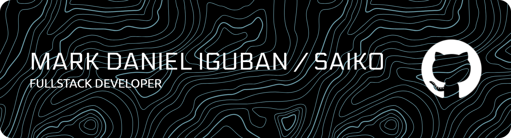

<h1 align="center">
    
</h1>

  
**Computer Science Student | Full-Stack Developer | Computer Vision Researcher**

*Passionate about creating scalable applications and solving real-world problems through technology*

---

## Featured Projects

<table>
<tr>
<td width="50%" valign="top">

### **ProjTrack - Electrical Engineering Management System**
A comprehensive full-stack project management platform designed to streamline engineering workflows and enhance team collaboration.

**[Live Demo](https://projtrack-portfolio-demo.vercel.app/)**  

**Built With:**
- Next.js 15 + TypeScript + React 19
- Supabase (PostgreSQL) + TanStack Query  
- Tailwind CSS + Radix UI + Framer Motion
- PDF Export + Real-time Updates

**Key Achievements:**
- **40-50% reduction** in API calls through query optimization
- **Modular architecture** with reusable components
- **Mobile-responsive** design for field operations
- **Real-time collaboration** with Supabase integration

</td>
<td width="50%" valign="top">

### **Frozen Shoulder Rehabilitation Decision Support System**
A CPU-only computer vision prototype for supervised rehabilitation that analyzes shoulder flexion and abduction, evaluates movement quality, and produces auditable session reports.

**Thesis Research Project**  

**Built With:**
- Python + MediaPipe + OpenCV
- NumPy + Pandas + Tkinter
- Matplotlib + ReportLab
- Rule-based Logic + Mamdani Fuzzy Inference

**Key Achievements:**
- **Real-time pose analysis** for ROM and repetition tracking
- **Compensation detection** for trunk lean and shoulder hiking
- **Confidence-aware filtering** with CW-EMA and BLC checks
- **386 PT-matched repetitions** used for technical evaluation
- **0.717 F1 / 0.625 kappa** for combined ROM insufficiency

</td>
</tr>
</table>

---

## Tech Stack & Tools

### Programming Languages

### Frameworks & Libraries

### Databases & Backend

### Cloud & Deployment

### Development Tools & IDEs

### Game Development & Creative Tools

### Operating Systems

---

## Current Learning Path

<table>
<tr>
<td width="50%" valign="top">

### **Now Focusing On:**
- **Computer Vision Systems** - Pose estimation and movement analysis
- **Performance Optimization** - Efficient data processing and responsive applications
- **System Design** - Modular, maintainable application architecture
- **Research Evaluation** - Reproducible metrics, validation, and technical reporting

</td>
<td width="50%" valign="top">

### **Learning Queue:**
- **Cloud Architecture** - AWS and containerization
- **Mobile Development** - React Native and PWAs  
- **DevOps & Security** - CI/CD, testing, and authentication
- **Data Analytics** - Visualization and interpretable insights

</td>
</tr>
</table>

---

## Achievements & Highlights

| **Project Metrics** | **Technical Growth** |
|:---:|:---:|
| **386** PT-matched repetitions evaluated | **Computer vision** pipeline development |
| **40-50%** API-call reduction | **Full-stack** system architecture |
| **Real-time** pose and project updates | **Research-grade** evaluation workflow |
| **Auditable** CSV and PDF reporting | **Performance** optimization |

---

## Connect & Collaborate

---

## Developer Philosophy

*"Code is not just about solving problems - it is about crafting thoughtful solutions that make a meaningful impact on people's lives."*

**Fun Fact:** When I am not coding, you will find me reading manga or manhwa, or exploring new frameworks.

---

  

**Thanks for visiting. Let's build something useful together.**

